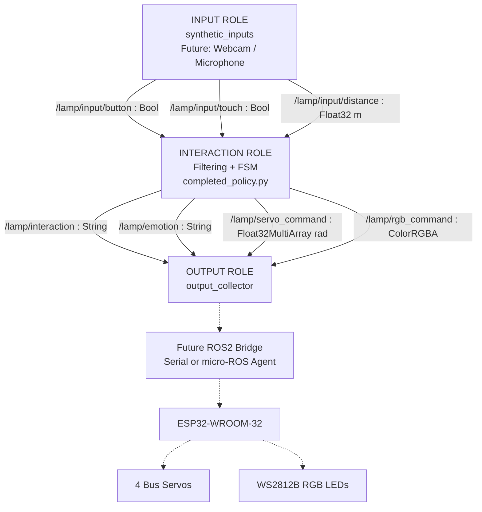

# Lab07 Student Worksheet
**หัวข้อ:** Seven-topic ROS 2 Bridge and Experimental Design — Robot Lamp

**ชื่อกลุ่ม:** ....................................  
**วันที่:** 05/11/2569  
**Policy version:** Completed Lab06 Group Policy  
**Policy SHA-256:** 3EDB5BFF93F58EB11F401CDFBB7DEE4ABB3B7EC39BD3A95D7107E97E09BB714D

## 1. ROS 2 Architecture และ 7 Topics

โครงงาน Robot Lamp ออกแบบการทำงานเป็น 3 Roles ได้แก่ Input, Interaction และ Output โดยใช้ ROS 2 Topics จำนวน 7 Topics เพื่อเชื่อมโยงข้อมูลเซนเซอร์ การประมวลผลสถานะอารมณ์ และคำสั่งควบคุมหุ่นยนต์

### 1.1 แผนภาพระบบ



### 1.2 ตาราง Topic Contract

| Topic | Message Type | หน่วย/ข้อมูล |
|---|---|---|
| `/lamp/input/button` | Bool | true/false |
| `/lamp/input/touch` | Bool | true/false |
| `/lamp/input/distance` | Float32 | m |
| `/lamp/interaction` | String | Event |
| `/lamp/emotion` | String | Emotion State |
| `/lamp/servo_command` | Float32MultiArray | rad |
| `/lamp/rgb_command` | ColorRGBA | RGB 0–1, alpha=1 |

**QoS:** RELIABLE, KEEP_LAST depth 10, VOLATILE

ส่วน ROS 2 Agent/Bridge และ ESP32 เป็นส่วนขยายในอนาคต ยังไม่ได้ทดสอบการสื่อสาร ROS 2 หรือการขับ Servo จริงในการทดลอง Offline นี้

## 2. Servo Command, RGB และ Hardware Calibration

### 2.1 Servo Command

คำสั่ง Servo ใช้ `Float32MultiArray` โดยจัดลำดับข้อมูลดังนี้:

`[tilt, extend, nod]`

ทุกค่าอยู่ในหน่วยเรเดียน (rad) โดย `extend` เป็นชื่อแกนเชิงความหมายในแบบจำลอง ไม่ใช่ระยะเชิงเส้นหน่วยเมตร

ตัวอย่างสถานะ Interested:

```python
servo_command = [0.22, 0.18, 0.06]
```

### 2.2 RGB Command

คำสั่ง RGB ใช้ `ColorRGBA` โดยแปลงค่าสี 0–255 เป็น 0–1 ด้วยสูตร:

`RGB_normalized = RGB_integer / 255`

ตัวอย่างสถานะ Interested มีค่า RGB = (255, 180, 0)

```python
r = 255 / 255   # 1.0000
g = 180 / 255   # 0.7059
b = 0 / 255     # 0.0000
a = 1.0
```

### 2.3 Hardware Calibration Plan

โครงงาน Robot Lamp ใช้ ESP32-WROOM-32, Bus Servo 4 ตัว, Waveshare Bus Servo Adapter และไฟ WS2812B

ก่อนควบคุม Hardware จริงต้องตรวจสอบ Servo ID, ตำแหน่งศูนย์, ทิศทางการหมุน, องศาสูงสุดและต่ำสุด, ขีดจำกัดความเร็ว และการแปลงคำสั่งเชิงความหมายทั้งสามแกนไปยัง Servo จริงทั้งสี่ตัว

ต้องตรวจสอบแรงดันและกระแสไฟเลี้ยง พร้อมระบบ STOP และ Watchdog ก่อนเริ่มการเคลื่อนไหว

## 3. Research Question, Hypothesis และ Experimental Protocol

### Research Question

การจำลองการสื่อสารที่มี Delay, Jitter และ Message Drop ส่งผลต่อความสามารถในการตอบสนองและการเกิด Fault ของ Robot Lamp อย่างไร เมื่อเปรียบเทียบกับระบบสื่อสารอุดมคติ?

### Hypothesis

C1 ซึ่งมี Delay และ Message Drop คาดว่าจะมีการตอบสนองภายใน 1 วินาทีน้อยกว่าหรือเท่ากับ C0 และเกิด Fault Ticks มากกว่า C0

### Independent Variable

รูปแบบการสื่อสาร 2 เงื่อนไข

- C0: ไม่มี Transport Delay และ Message Drop
- C1: มี Delay 0–0.18 s, Random Drop Probability 0.08 และ Burst Loss 12.50–12.70 s

### Controlled Variables

ใช้ FSM Policy เดียวกัน, Synthetic Input เดียวกันภายในแต่ละ Paired Seed, ระยะเวลาจำลอง 22 s, Time Step 0.02 s และ Scheduler Delay 0.04 s

### Expected Input IDs

กำหนดชุด Positive Inputs ตาม Baseline Contract จำนวน 7 รายการ:

`button_01`, `touch_01`, `approach_01`, `clear_01`, `near_01`, `clear_02`, `button_02`

เกณฑ์ความสำเร็จคือพบทั้ง Motion และ RGB Onset ภายใน 1 s นับจาก Source Time โดยสังเกตผลภายใน Trial 22 s

ใบงานนี้จัดทำจากผลการทดลองที่บันทึกไว้แล้ว จึงไม่อ้างว่าเป็นหลักฐานการลงทะเบียนสมมติฐานก่อนรัน

## 4. Paired Repeats และ Experimental Results

ทดลอง C0 และ C1 อย่างละ 3 รอบ โดยใช้ Paired Seeds 41, 42 และ 43 รวมทั้งหมด 6 Trials

**Metric 1:** จำนวน Expected Inputs ที่ตอบสนองทั้ง Motion และ RGB ภายใน 1 s (Pass/7)

**Metric 2:** จำนวน Fault Ticks จาก 1101 Simulation Ticks

| Pair / Seed | C0 Pass/7 | C1 Pass/7 | C0 Fault Ticks | C1 Fault Ticks | Missing C0 / C1 | Interpretation |
|---|---|---|---|---|---|---|
| 1 / 41 | 7 | 6 | 20 | 54 | 0 / 1 | C1 ตอบสนองขาด 1 |
| 2 / 42 | 7 | 6 | 20 | 81 | 0 / 1 | C1 มี Fault สูงสุด |
| 3 / 43 | 7 | 7 | 20 | 56 | 0 / 0 | ตอบสนองครบทั้งคู่ |

ข้อมูล Censored Deliveries ไม่ปรากฏแยกในตารางสรุปที่นำมารายงาน จึงต้องตรวจจาก `input_trace.csv` ก่อนระบุจำนวน ไม่ถือว่าเป็นศูนย์

### 4.1 Transport Results

| Seed | C0 Received | C1 Received | C1 Dropped | C1 Out-of-order |
|---|---:|---:|---:|---:|
| 41 | 3303 | 3031 | 257 | 1413 |
| 42 | 3303 | 3007 | 287 | 1421 |
| 43 | 3303 | 2991 | 300 | 1393 |

C0 ไม่มี Message Drop หรือ Out-of-order ในทั้งสามรอบ ขณะที่ C1 มี Message Drop และการรับข้อมูลผิดลำดับ

### 4.2 Max Observed Latency

| Seed | C0 (s) | C1 (s) |
|---|---:|---:|
| 41 | 0.14 | 0.20 |
| 42 | 0.14 | 0.22 |
| 43 | 0.14 | 0.18 |

ค่าดังกล่าวเป็น Latency ที่สังเกตได้เฉพาะกรณีที่พบ Onset ครบ ไม่รวมเหตุการณ์ Missing และไม่ใช่ Physical Servo/LED Latency

### 4.3 Evidence Paths

ไฟล์ผลทดลองอยู่ใน:

`lab_07/results/completed_run/`

แต่ละ Trial เก็บข้อมูลใน `C0_r01` ถึง `C0_r03` และ `C1_r01` ถึง `C1_r03` โดยมีไฟล์:

- `input_trace.csv`
- `command_trace.csv`
- `events.csv`
- `metrics.json`
- `config.json`

ไฟล์สรุประดับการทดลองอยู่ที่:

- `lab_07/results/completed_run/summary.json`
- `lab_07/results/completed_run/manifest.json`
- `lab_07/results/completed_run/report.html`

### 4.4 Replay Verification

Replay จากต้นฉบับ `results/completed_run/C1_r02/input_trace.csv` ไปยัง `results/replay_check/C1_r01/`

ผลการเปรียบเทียบ SHA-256:

- `command_trace.csv`: MATCH
- `events.csv`: MATCH

แสดงว่าผลลัพธ์ทั้งสองไฟล์ตรงกับต้นฉบับแบบ Byte-for-byte ภายใต้การรันครั้งนี้

## 5. Invalid/Stale Probe และ Communication Stress

Baseline Invalid/Stale Probe เป็นเหตุการณ์จำลองสำหรับตรวจการทำงานของ Fault Handling เช่น ข้อมูลเซนเซอร์ผิดรูปแบบหรือข้อมูลหมดอายุ ซึ่งมีอยู่ในทั้งสอง Conditions

ส่วน Communication Stress เป็นปัจจัยที่เพิ่มใน C1 ได้แก่ Transport Delay, Jitter, Random Message Drop, Burst Loss และ Out-of-order Delivery

จากผลทดลอง C0 มี Fault 20 Ticks ทุกรอบ ส่วน C1 มี 54, 81 และ 56 Ticks แสดงว่าระบบ C1 มี Fault มากกว่าในแบบจำลองนี้

อย่างไรก็ตาม C1 เปลี่ยนทั้ง Delay และ Drop ใน Condition เดียวกัน จึงไม่สามารถสรุปได้ว่า Fault และ Missing Response เกิดจาก Delay หรือ Drop เพียงอย่างใดอย่างหนึ่ง

การวิเคราะห์เชิงสาเหตุเพิ่มเติมควรแยกการทดลอง Delay-only และ Drop-only

## 6. Timestamp, Clock Synchronization และ Physical Measurement

ROS 2 Messages ชนิด Bool, String, Float32 และ ColorRGBA ที่ใช้ใน Lab 07 ไม่มี Header สำหรับ Source Timestamp

ดังนั้น Receiver ไม่สามารถทราบเวลา Acquisition ของเซนเซอร์จริงได้โดยตรง และไม่ควรคำนวณ Source-to-Output Latency จาก Timestamp ของแต่ละ Node โดยไม่มี Clock Synchronization

### Measurement Plan

1. กำหนด Input ID และ Sequence Number ใน Sidecar Log เพื่อเชื่อมโยง Source กับ Output
2. เก็บ `perf_counter_ns`, Host ID, Node ID, Topic, Phase และ Payload
3. ใช้นาฬิกาที่สัมพันธ์กัน พร้อมบันทึก Offset, Error Bound และความละเอียดของการวัด
4. ใช้กล้องหรืออุปกรณ์วัดตำแหน่ง Servo เพื่อตรวจ Physical Motion Onset
5. ใช้ Photodiode หรือกล้องเพื่อตรวจ Physical RGB Onset

การทดลอง Offline ใช้ Virtual Clock ภายใน Process เดียว ไม่ใช่ ROS/DDS Network Benchmark และไม่ได้วัดการเคลื่อนที่ของ Servo หรือแสงจาก LED จริง

## 7. Proposal — AHM, SO(2) CPG และ Real Robot

จัดทำข้อมูลใน `proposal.json` และผ่านการตรวจสอบความครบถ้วนของ Checker แล้ว โดยมีข้อความผลตรวจ:

`PASS: fields complete; lecturer must review scientific validity`

### 7.1 Biological Inspiration

โครงงาน Robot Lamp ได้แรงบันดาลใจจากกลไกทางชีวภาพที่สัตว์สร้างจังหวะการเคลื่อนไหวด้วย Central Pattern Generator (CPG) และปรับเปลี่ยนพฤติกรรมด้วยกระบวนการ Neuromodulation

### 7.2 Artificial Hormone Model (AHM)

เสนอใช้ฮอร์โมนเทียมหนึ่งตัวคือ Arousal เพื่อควบคุมระดับการตอบสนองต่อมนุษย์ โดยใช้สมการออกแบบเบื้องต้น:

`A[k+1] = clip(A[k] + dt*(alpha*u[k] - beta*A[k]), 0, 1)`

กำหนดค่าเบื้องต้น `alpha=0.75 1/s` และ `beta=0.30 1/s` ซึ่งยังไม่ได้สอบเทียบกับ Hardware

### 7.3 SO(2) CPG

เสนอใช้โครงข่ายประสาทเทียมแบบ Recurrent Two-Neuron Oscillator ในแนวทาง SO(2) CPG เพื่อสร้างจังหวะการเคลื่อนไหวของโคมไฟ

`o[k+1] = tanh(W(phi)*o[k] + b)`

โดยใช้ `phi=0.20 rad/step` และ `g=1.10` เป็นค่าเริ่มต้นที่เสนอสำหรับ Simulation ซึ่งต้องตรวจสอบกับสมการในเอกสารรายวิชา

### 7.4 Integration

FSM เป็นตัวกำหนดสถานะ Normal, Interested, Happy, Afraid และ Sleepy ส่วน AHM จะปรับระดับ Arousal เพื่อควบคุม Amplitude ของ CPG สำหรับการเคลื่อนไหว Servo

ระบบ Fault และ STOP มีลำดับความสำคัญสูงกว่า CPG เสมอ

AHM และ CPG ยังเป็นแผนการพัฒนา ไม่ใช่ส่วนที่ได้รับการพิสูจน์จากผล Offline 6 รอบ

### 7.5 Simulation and Real Robot

Simulation ใช้ C0/C1 อย่างละ 3 Repeats พร้อม Metrics อย่างน้อย 2 ตัว ได้แก่ Response Success และ Fault Ticks

Real Robot มีแผนใช้ ROS 2 Jazzy เชื่อมต่อ ESP32 เพื่อควบคุม Servo 4 ตัวและไฟ RGB โดยทดสอบอย่างน้อย 3 รอบต่อ Condition หลังผ่านการตรวจสอบด้านความปลอดภัย

กำหนด Human Interaction Scenario ระยะเวลา 600 s ภายใต้การควบคุมดูแล พร้อมการขอความยินยอมจากผู้เข้าร่วม การสอบเทียบ Servo การติดตาม Latency และ Emergency Stop

### 7.6 Safety และ Timeline

ระบบต้องมี Manual STOP, Power Cutoff, Servo Limits, Communication Watchdog และ Neutral Fallback

แผนการพัฒนาเบื้องต้นในเดือนพฤศจิกายน 2569 ได้แก่ ตรวจสอบ ROS Topic Contract, พัฒนา AHM/CPG Simulation, สอบเทียบ Servo และ RGB, ทดสอบหุ่นยนต์จริงเมื่อผ่านเกณฑ์ Safety และวิเคราะห์ผลการทดลอง

การทดสอบ Hardware และ Human Scenario ยังไม่ได้ดำเนินการจริง

## Checklist

- [x] ROS 2 Architecture Graph และ 7 Topics
- [x] Topic Units และ QoS
- [x] Completed Policy Checker 40/40
- [x] Offline Raw Data, Config และ Replay SHA-256 ในเครื่อง
- [x] Paired Seeds 41, 42, 43
- [x] Missing Response และข้อจำกัดการวัด
- [x] Measurement Boundary และ Clock Plan
- [x] Proposal JSON ผ่าน Structural Checker
- [ ] ตรวจยืนยัน Scientific Validity กับผู้สอน
- [ ] จัดทำ Proposal Word 2–3 หน้า
- [ ] ทดสอบ ROS 2 และ Real Robot ตามแผน
- [ ] ตรวจหลักฐานและ Push GitHub
